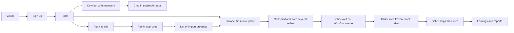

<p align="center">
  
</p>

<h1 align="center">Nexora</h1>

<p align="center"><strong>A social network and multi-vendor marketplace in one WordPress site.</strong></p>

<p align="center">
Members build a profile, connect with people they trust, chat in organised conversations, and buy from or sell to each other.<br>
Anyone can apply to become a seller: approved sellers list products by hand, CSV or API, ship orders, and watch their earnings,<br>
with the platform's commission worked out and recorded on every order line.
</p>

<p align="center">
  
  
  
  
  
  
</p>

<p align="center">
  <a href="#features">Features</a> ·
  <a href="#screenshots">Screenshots</a> ·
  <a href="#how-it-works">How it works</a> ·
  <a href="#technology">Technology</a> ·
  <a href="#install">Install</a> ·
  <a href="#usage">Usage</a> ·
  <a href="#troubleshooting">Troubleshooting</a> ·
  <a href="#development">Development</a>
</p>

---

## Features

| | |
|---|---|
| **Member profiles** | Personal, address and work details, a profile photo and cover image, identity documents, and a personal content feed. Email, phone, address and documents stay private to the owner. |
| **Connections** | Search members, send, accept or decline requests, see all your connections and the ones you share with another member. |
| **Chat** | Threads that each start with a subject, only between connected members. Removing a connection closes the shared threads. |
| **Become a seller** | Choose "Seller" at sign-up or "Become a seller" later. An administrator approves, rejects or suspends the application. GSTIN and business details are validated. |
| **Products and imports** | Add products with a form, or import them from a CSV file (up to 500 rows) or an API (DummyJSON, Fake Store, the Nexora format, or your own). Every import starts with a **dry-run preview** that writes nothing. |
| **One cart, many sellers** | A shared cart grouped by seller. Prices, names and stock are always read from the product on the server, so nothing a browser sends can change what you pay. |
| **Orders and commission** | Checkout runs on WooCommerce (cash on delivery or bank transfer). Each order line freezes the price, seller and commission (10% by default) in whole cents. Stock is taken atomically and given back on cancels and refunds. |
| **Fulfilment and alerts** | Sellers mark their own lines shipped. Customers get a shipped e-mail, sellers get new-order and low-stock alerts, and everyone gets in-app notifications. |
| **Earnings and reports** | A Sales tab with 7, 30 or 90 days or all-time totals, a daily earnings chart, best sellers and an order table. Refunds reverse the seller's share automatically. |
| **Admin control** | Approve and suspend sellers, edit records, set commission, categories and the low-stock threshold, and see a marketplace overview with a per-seller table. |
| **Privacy by design** | ID documents live in a private folder and are served only to their owner or an administrator. A seller never sees a buyer's billing details, e-mail or phone. |
| **Theme and sample pages** | A navy-and-blue theme with Elementor Pro Theme Builder support. One click creates Home, About, Contact, FAQs and the legal pages, plus the header, footer and 404. |

## Screenshots

Screenshots are not in the repository yet. They must come from a running site, so they are added after a first install ([Install](#install)). Good ones to take: the landing page, a profile dashboard, the Marketplace tab, the cart grouped by seller, the Sales tab and the admin marketplace overview. Save them in `docs/screenshots/` and link them here.

## How it works



1. **Join.** Sign up as a customer or a seller. A seller application waits for an administrator.
2. **Build a profile and a network.** Add your details, connect with members and chat.
3. **Sell.** Once approved, list products one by one or import a CSV or API feed. You preview first, then apply exactly what you previewed.
4. **Buy.** Add products from several sellers to one cart and check out. Only the product id and quantity come from the browser; the server decides everything else.
5. **Fulfil and earn.** Each seller sees only their own lines, ships them, and follows their earnings. Only **Processing** and **Completed** orders count as earnings.

## Technology

| Layer | Technology |
|---|---|
| Platform | WordPress (7.1 ships in the repository; the plugin needs 6.4+) and WooCommerce for cart, checkout, orders and stock |
| Language | PHP 8.0+, PSR-4 (`Nexora\` namespace in `src/`), no framework |
| Data | MySQL or MariaDB: custom post types for profiles, sellers, products and connections, plus five custom tables for notifications and chat |
| Front end | Plain CSS and JavaScript, one design-token set (`--nx-*`), SweetAlert2 |
| Theme | Nexora theme (classic PHP) with Elementor Pro Theme Builder support |
| E-mail | `wp_mail`, delivered through WP Mail SMTP |
| Security | Nonces, server-side ownership checks, rate limiting, encrypted API keys, private file storage |
| Quality | WP-CLI test suite, golden markup snapshots, WordPress Coding Standards (PHPCS), GitHub Actions |
| Containers | Docker Compose: Apache, PHP 8.3, MariaDB 10.11, WP-CLI, Composer |

### Quality

| Check | What it proves |
|---|---|
| 90 test files in `tests/php/` | Accounts, products, imports, cart, orders, refunds, earnings, privacy and security rules |
| Golden snapshots (`tests/golden/`) | The exact markup of every screen, so a refactor cannot change it silently |
| Security matrix (`docs/SECURITY-MATRIX.md`) | Every entry point (AJAX action, shortcode, cron event, request hook) is listed, and a test fails if one is missing |
| Isolation guard (`tests/guard.sh`) | Tests refuse to run on the site's real database and restore every setting they touch |
| PHPCS and design-system tests | Code style, no raw colours or `!important`, and translated strings |

## System requirements

| | Minimum | Tested with |
|---|---|---|
| WordPress | 6.4 | 7.1 |
| PHP | 8.0 | 8.3 |
| Database | MySQL or MariaDB | MySQL 8.0 (CI), MariaDB 10.11 (Docker) |
| WooCommerce | current release | 11.2.1 |
| Web server | Apache with `mod_rewrite` | the site is served under `/nexora/` |
| E-mail | A working mail setup | WP Mail SMTP |

## Dependencies

| Dependency | Purpose | Version | Install manually? |
|---|---|---|---|
| WordPress | Core | 7.1 | No, it is in the repository |
| WooCommerce | Cart, checkout, orders, stock | 11.2.1 | **Yes**, through wp-admin |
| Advanced Custom Fields (free) | Administrator edit screens | 6.8.10 | **Yes**, through wp-admin |
| Elementor and Elementor Pro | Optional: Theme Builder header, footer, 404 and sample pages | Elementor 4.3.4, Pro 4.2.3 | Yes. Pro is licensed, so keep your own licence active |
| WP Mail SMTP | Reliable e-mail for one-time codes and order mails | any | Yes |
| Docker Desktop or XAMPP | Local environment | recent | Yes |
| Composer | Coding-standards tooling (development only) | 2.x | Development only |
| WP-CLI | Tests and migrations (development only) | 2.12 | Development only |

No paid or external service is required to run the marketplace. reCAPTCHA keys are optional, and an Elementor Pro licence is needed only for the Theme Builder templates.

## Install

### Option A: Docker (quickest)

1. Install [Docker Desktop](https://www.docker.com/products/docker-desktop/).
2. Get the code and start the containers:

   ```bash
   git clone https://github.com/singla25/Nexora.git
   cd Nexora
   docker compose up -d --build
   ```

3. Open **http://localhost:8080/nexora/** and run the WordPress installer. (To start from an existing site, put a `mysqldump` in `docker/db-init/10-nexora.sql` before the first start; see [`docker/README.md`](docker/README.md).)
4. Install and activate the plugins and the theme:

   ```bash
   docker compose exec -u www-data web wp plugin install woocommerce advanced-custom-fields --activate
   docker compose exec -u www-data web wp plugin activate nexora
   docker compose exec -u www-data web wp theme activate nexora-theme
   ```

5. Create the pages. With Elementor and Elementor Pro active, open **Appearance → Sample Content** and press **Install sample content**; it creates the Home (front page), About, Contact, FAQs, Privacy Policy, Terms of Use and Community Guidelines pages, the Login, Registration and Profile pages, the header, footer and 404 templates, and the menus. Otherwise create pages with the slugs `login-page`, `registration-page` and `profile-page` and the shortcodes in the table below.
6. Save **Settings → Permalinks** once, so `/profile-page/<username>` works.
7. Under **Nexora System → Settings**, set the default images, admin e-mail, commission, product categories and (optionally) reCAPTCHA keys. In WooCommerce, turn **Coming soon** mode **off**.

### Option B: your own Apache and MySQL (XAMPP, Hostinger, a VPS)

1. Place the project in your web root so it is served at `/nexora/` (change `RewriteBase` in `.htaccess` if you host it elsewhere).
2. Create a database, copy `wp-config-sample.php` to `wp-config.php`, and fill in the credentials and salts.
3. Run the installer at `/nexora/wp-admin/install.php`, or import a backup.
4. Install and activate WooCommerce and Advanced Custom Fields, then activate the **Nexora** plugin and the **Nexora** theme (activation creates the notification and chat tables).
5. Continue with steps 5 to 7 above.

Before you go live, work through [`docs/LAUNCH-CHECKLIST.md`](docs/LAUNCH-CHECKLIST.md): HTTPS, a real cron, off-server backups, reCAPTCHA keys and removing test data.

### Shortcodes

| Shortcode | Use on page |
| --- | --- |
| `[nexora_home]` | Landing page (live numbers, text editable under Nexora System) |
| `[profile_registration]` | Registration page |
| `[profile_login]` | `/login-page` |
| `[profile_dashboard]` | `/profile-page` (also served at `/profile-page/<username>` through a rewrite rule) |
| `[nexora_stat type="members\|connections\|posts\|chats"]` | Any Elementor Shortcode widget: a live platform number |
| `[nexora_auth_buttons]` | Header: Log in / Sign up, or profile / Log out when logged in |
| `[nexora_contact_form]` | Contact page: a spam-protected form that e-mails the admin |

## Usage

1. **Sign up or log in** at `/login-page`. New members land on their profile.
2. **Fill in your profile.** Add your details, a photo and a cover image, and upload documents (images or PDF, up to 8 MB each).
3. **Connect and chat.** Find members, send requests, and open a chat thread with a subject once a request is accepted.
4. **Become a seller.** Use "Become a seller" on your profile, give your business details, and wait for approval. The status shows on your profile.
5. **Add products** (approved sellers). Use the form, or **Import**: choose a CSV or an API source, read the preview, then apply it. Imports can be repeated without creating duplicates.
6. **Shop.** Open the **Marketplace** tab, add products from one or more sellers to the cart, and check out. Follow your orders under **My Orders**.
7. **Ship and track** (sellers). Open the **Sales** tab, open an order, mark your lines shipped, and read your totals and chart. Low-stock and new-order alerts arrive by e-mail and in the notification list.
8. **Run the marketplace** (administrators). Review seller applications under **Nexora System**, set commission and categories, and open the **Marketplace overview** for totals per seller.

## Troubleshooting

<details>
<summary>AJAX actions return <code>-1</code> or <code>0</code></summary>

`-1` means WordPress rejected the nonce: it is missing, expired, or came from a cached page. `0` means no handler is registered for that action, so check the spelling and use the `nexora_` name. Chat actions use `nexora_chat_nonce`, not `profile_nonce`.
</details>

<details>
<summary><code>/profile-page/&lt;username&gt;</code> shows a 404</summary>

The rewrite rule is not stored or the `profile-page` page is missing. Create the page with the `[profile_dashboard]` shortcode and save **Settings → Permalinks** once.
</details>

<details>
<summary>Customers cannot reach the cart or checkout</summary>

WooCommerce **Coming soon** mode hides the cart, checkout and shop from everyone except administrators. Turn it off under WooCommerce → Settings → Site visibility.
</details>

<details>
<summary>A CSS or JavaScript change is not visible</summary>

The browser or a page cache holds the old file. Bump `NEXORA_VERSION` (plugin) or `NXT_VERSION` (theme), hard-refresh, and clear any LiteSpeed or CDN cache.
</details>

<details>
<summary>The captcha blocks me on a local site</summary>

The captcha is skipped only on a genuinely local site: `WP_ENVIRONMENT_TYPE` must be `local` **and** the site's hostname must resolve to a private address.
</details>

<details>
<summary>One-time codes and order e-mails do not arrive</summary>

They are sent with `wp_mail`, so the server needs working mail. Install and test WP Mail SMTP. Queued order e-mails run on WP-Cron, which needs site visits or a real server cron.
</details>

<details>
<summary>The numbers on the home page look wrong</summary>

They are cached for an hour in the `nexora_home_stats` transient. It is flushed when members or posts change; to force it, run `wp transient delete nexora_home_stats`.
</details>

<details>
<summary>The tests refuse to run</summary>

By design, tests never run on the database in `wp-config.php`. Point them at a scratch copy: `NX_TEST_DB=<scratch db> tests/run.sh`.
</details>

More problems and fixes are in [`docs/TROUBLESHOOTING.md`](docs/TROUBLESHOOTING.md).

## Development

```bash
# tests: always on a scratch copy of the database
NX_TEST_DB=nexora_test tests/run.sh                          # everything
NX_TEST_DB=nexora_test tests/run.sh tests/php/test-foo.php   # one file

# coding standards (must report nothing)
cd wp-content/plugins/nexora && composer install && vendor/bin/phpcs
vendor/bin/phpcbf                                            # auto-fix

# syntax check
find wp-content/plugins/nexora wp-content/themes/nexora-theme -name '*.php' -print0 | xargs -0 -n1 php -l | grep -v '^No syntax errors'

# translations: regenerate after changing any user-facing string
wp i18n make-pot wp-content/plugins/nexora wp-content/plugins/nexora/languages/nexora.pot --slug=nexora --domain=nexora --exclude=vendor,assets/lib
```

- A new module is one class under `src/<Module>/` plus a `new` line in `Core\Plugin::boot()`.
- AJAX actions are registered with `Http\Ajax::register()`; member handlers extend `Http\Member_Ajax`. Keep nonce and ownership checks on every handler, and add the action to `docs/SECURITY-MATRIX.md`.
- Bump `NEXORA_VERSION` in `nexora.php` whenever plugin PHP, CSS or JS ships.
- Run `docker compose exec -u www-data web ...` for any command inside the Docker setup (see [`docker/README.md`](docker/README.md)).

## Project structure

```text
nexora/                               a full WordPress install; only these parts are ours
├── wp-content/
│   ├── plugins/nexora/               the plugin
│   │   ├── nexora.php                constants, autoloader, activation, Plugin::boot()
│   │   ├── src/                      PSR-4 classes, one folder per module
│   │   │   ├── Core, Http, Auth, Profile, Connections, Notifications, Content, Chat
│   │   │   ├── Accounts, Vendors, Products, Imports, Marketplace, Orders, Integrations
│   │   │   └── Admin, Admin_Edit, PostTypes, Shortcodes, Database
│   │   ├── templates/                HTML only, every value escaped here
│   │   ├── assets/                   css/, js/, lib/
│   │   └── languages/                nexora.pot
│   └── themes/nexora-theme/          the theme and the Elementor sample-content installer
├── tests/                            WP-CLI test suite, golden snapshots, CI helpers
├── docs/                             specification, architecture and reference documents
├── docker/ and docker-compose.yml    optional Docker development environment
└── .github/workflows/tests.yml       tests and coding standards on every push
```

More detail: [`docs/SPEC.md`](docs/SPEC.md) (the marketplace rules and which order statuses count as earnings), [`docs/ARCHITECTURE.md`](docs/ARCHITECTURE.md), [`docs/AJAX-API.md`](docs/AJAX-API.md), [`docs/DATABASE.md`](docs/DATABASE.md), [`docs/THEME.md`](docs/THEME.md), [`docs/DESIGN-SYSTEM.md`](docs/DESIGN-SYSTEM.md), [`docs/ROADMAP.md`](docs/ROADMAP.md) and [`docs/NEXORA-DEVELOPER-GUIDE.md`](docs/NEXORA-DEVELOPER-GUIDE.md).

## What is not in git

`.gitignore` excludes `wp-config.php`, `.env`, `wp-content/uploads/`, caches and backup folders (`updraft/`, `ai1wm-backups/`, `*.sql`, `*.wpress`). Get database dumps and uploads separately and never commit them, since they contain user data.

## License and support

WordPress core is licensed under GPLv2 or later (see `license.txt`), and third-party plugins keep their own licences. The Nexora plugin and theme were written by Sahil Singla; no separate licence file is included yet, so decide on one before sharing the code.

Questions and bug reports: [GitHub Issues](https://github.com/singla25/Nexora/issues).
